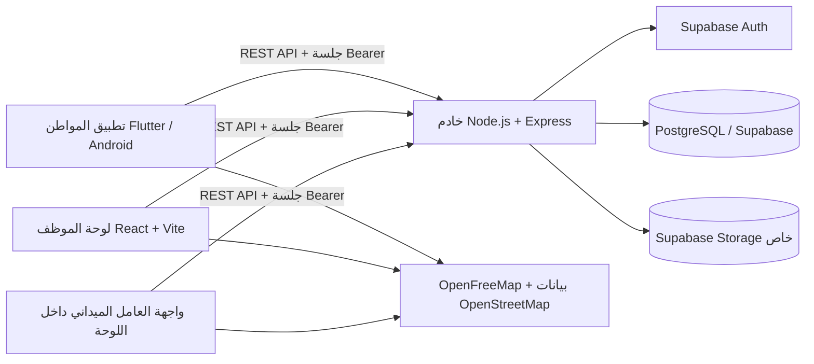

# الملف المرجعي الكامل لمشروع «بلاغي»

> أُعد هذا الملف لنقل سياق المشروع إلى نموذج ذكاء اصطناعي آخر. يشرح الفكرة، نطاق النسخة الحالية، المعمارية، الأدوار، سير العمل، قاعدة البيانات، واجهات API، الأمن، التشغيل والتطوير. لا يحتوي على مفاتيح أو كلمات مرور أو بيانات سرية.
>
> **قاعدة مهمة:** هذا الملف يصف التنفيذ الحالي بحسب الكود الموجود في المستودع بتاريخ 8 نوفمبر 2026، ومعه `docs/SRS.md` و`docs/wireframes.md` المحدّثان في التاريخ نفسه. عند التعارض يُقدَّم الكود الحالي والقرارات الحديثة التي وافق عليها صاحب المشروع، ويجب إخبار المستخدم بأي تعارض قبل إعادة تصميم سلوك قائم.

## 1. بطاقة المشروع

- الاسم العربي: **بلاغي**.
- العنوان الأكاديمي بالإنجليزية: **Balaghi: A Mobile Application for Civic Issue Reporting with a Web-Based Dashboard for Report Management**.
- النوع: مشروع تخرج في هندسة البرمجيات.
- الكلية بحسب معلومات المشروع: الكلية التقنية الإلكترونية، ليبيا.
- الهدف: تمكين المواطن من إرسال بلاغ موثق بصورة وموقع عن مشكلات البنية التحتية، وتمكين الموظف والجهة المنفذة من مراجعة البلاغ ومتابعة إصلاحه حتى يؤكد الموظف الحل.
- البلدية المستهدفة في النسخة الأولى: بلدية طرابلس المركز.
- المنصة الأساسية: تطبيق Android للمواطن، وواجهة ويب عربية للموظفين والعاملين الميدانيين.
- أسماء فريق المشروع التي زوّد بها صاحب المشروع: أحمد لؤي المكي، علي معتوق غميض، محمود علي الحصين. اسم المشرف لم يحدد بعد.

## 2. المشكلة التي يعالجها المشروع

تصل بلاغات الطرق والمياه والنظافة للجهات أحيانًا دون وصف أو موقع موثوق، ويصعب على المواطن معرفة ما حدث بعد التبليغ. «بلاغي» ينظم العملية من التقاط صورة المشكلة حتى مراجعة موظف البلدية لنتيجة الإصلاح. لا يُنشر البلاغ للعامة فور الإرسال: يراجعه الموظف أولًا، وقد يطلب تحققًا ميدانيًا قبل اعتماده.

### منهجية التطوير

المواصفات والملفات الحالية لا توثّق اعتماد Scrum رسميًا أو اجتماعات/أدوار/مدة Sprint محددة. طريقة العمل الظاهرة من تطور المشروع هي تطوير تكراري تدريجي: تصميم شاشة أو مسار، مراجعته مع صاحب المشروع، ثم تنفيذه وتحسينه قبل الانتقال للخطوة التالية. عند كتابة التقرير الأكاديمي، يمكن وصفها بأنها **منهجية تكرارية/تزايدية مستوحاة من Agile**؛ لا تدّعِ تطبيق Scrum كاملًا ما لم يوثق الفريق مراسمه وأدواره فعلًا.

## 3. نطاق النسخة الأولى

### ضمن النطاق

1. مشاهدة خريطة البلاغات العامة وتفاصيل البلاغ المعتمد دون تسجيل الدخول.
2. دخول المواطن برقم الهاتف ورمز OTP، مع إدخال الاسم عند أول دخول. يولّد Supabase الرمز ويتحقق منه، ويرسله عبر منصة «رسالة» (resala.ly) من خلال Send SMS Hook: يستدعي Supabase المسار `POST /api/auth/sms-hook` بطلب موقّع، فيرسل الخادم الرمز بقالب معتمد في رسالة (`backend/src/smsHook.js` و`backend/src/resala.js`). الإعداد في README الخادم، قسم «Sign-in codes by SMS».
3. إنشاء بلاغ بصورة ملتقطة بالكاميرا فقط، وتصنيف، ووصف اختياري، وموقع.
4. حصر الإرسال في النطاق الجغرافي الذي رسمه صاحب المشروع لطرابلس المركز.
5. مراجعة الموظف واعتماد البلاغ أو رفضه مع سبب.
6. إمكانية طلب تحقق ميداني اختياري قبل نشر البلاغ.
7. إسناد البلاغ تلقائيًا إلى جهة العمل بحسب تصنيفه.
8. استلام العامل البلاغ بحسابه وتأكيد بدء المعالجة.
9. إرسال العامل ملاحظة ميدانية عند وجود مشكلة، أو إرسال صورة بعد الإصلاح.
10. مراجعة الموظف لطلب الإنجاز وتأكيد الحل أو إعادته للعامل مع سبب.
11. عرض «بلاغاتي» للمواطن، وسجل التغييرات والتفاصيل والإحصاءات للموظف.

### خارج النسخة الأولى أو غير مفعّل

- تحليل الصور بالذكاء الاصطناعي؛ اختيار التصنيف يدوي.
- إرسال إشعارات فورية إلى الهاتف.
- تعليقات عامة أو تصويت مجتمعي على البلاغات.
- دعم عدة بلديات أو مناطق تشغيل متعددة.
- إصدار iOS كامل.
- نظام عمل كامل دون إنترنت. حفظ البلاغ محليًا وإعادة المحاولة عند انقطاع الشبكة لا يعني أن الخرائط والخدمات تعمل بلا اتصال.
- Waze داخل التطبيق كخريطة مضمّنة. يمكن مستقبلًا فتح موقع البلاغ في تطبيق Waze عبر رابط ملاحة خارجي.

## 4. أنواع المستخدمين وصلاحياتهم

| الدور | الدخول | ما يستطيع فعله |
|---|---|---|
| زائر | دون حساب | مشاهدة البلاغات المعتمدة وغير المرفوضة على الخريطة وفتح تفاصيلها العامة. |
| مواطن | هاتف + OTP | إنشاء بلاغ، رؤية بلاغاته وحده وحالاتها وأسباب رفضها، تعديل الاسم، تسجيل الخروج. |
| موظف إداري `staff` | اسم مستخدم + كلمة مرور | مراجعة البلاغات، طلب تحقق ميداني، اعتماد/رفض البلاغ، تصحيح موقع أو تصنيف قبل الاعتماد، مراجعة الملاحظات الميدانية وطلبات الإنجاز، إدارة الحالة ومشاهدة الإحصاءات والخريطة. |
| عامل ميداني `field_worker` | اسم مستخدم + كلمة مرور | مشاهدة أعمال جهته، استلام البلاغ/طلب التحقق بحسابه، تأكيد بدء العمل، إرسال ملاحظة ميدانية أو صورة إنجاز. لا يرى بيانات المواطن ولا يقرر اعتماد البلاغ أو تأكيد الحل. |
| مسؤول رئيسي `admin` + `is_owner` | اسم مستخدم + كلمة مرور | كل صلاحيات الموظف وكل الصلاحيات الإدارية، وهو وحده يدير المسؤولين: ينشئهم ويعطّلهم ويحدد صلاحياتهم ويعيد تعيين كلماتهم. يُنشأ بسكربت الخادم فقط، ولا يمسّه أحد من اللوحة إلا رئيسي آخر يعيد تعيين كلمة مروره. |
| مسؤول عادي `admin` | اسم مستخدم + كلمة مرور | كل صلاحيات الموظف، وفوقها ما يمنحه الرئيسي فقط من: إدارة الموظفين، إدارة العمال الميدانيين، إدارة المواطنين، عرض سجل الإجراءات. لا يمنح صلاحية ولا يرفع صلاحيته ولا يمس حسابات المسؤولين. |

لا ينفذ أي مسؤول إجراءات العامل الميداني، فلا يرسل شخص واحد الإنجاز ويؤكده.

### دخول الموظف والعامل والمسؤول

Supabase Auth يتحقق من كلمة المرور باستخدام هوية بريد داخلية مرتبطة بالحساب (`username@STAFF_EMAIL_DOMAIN`). صاحب الحساب لا يدخل هذا البريد ولا يُطلب منه؛ يكتب اسم المستخدم وكلمة المرور. الخادم يحول اسم المستخدم إلى البريد الداخلي، يتحقق من Auth، ثم يراجع `role` و`is_active` و`must_change_password` في `profiles` مع كل طلب. لا تُخزَّن كلمة المرور في جدول التطبيق.

- **إنشاء الحسابات:** من قسم «الموظفون والعمال» في اللوحة، كلٌّ حسب صلاحيته: «إدارة الموظفين» للموظفين، «إدارة العمال الميدانيين» للعمال، والرئيسي وحده للمسؤولين (مع مربعات اختيار صلاحياتهم). يحصل الحساب الجديد على كلمة مرور مؤقتة عشوائية تظهر مرة واحدة. المسؤول الرئيسي يُنشأ بسكربت على الخادم (`npm run admin:create`)، ويُنصح باثنين؛ ولا توجد نقطة API تمنح صفة الرئيسي أو تزيلها.
- **رقم التواصل:** لكل حساب في اللوحة `profiles.contact_phone`، رقم جوال ليبي يكتبه المسؤول دون رمز تحقق، ويُقبل بأي صيغة شائعة ويُحفظ `+2189XXXXXXXX`. هو إلزامي في `POST /admin/users` وعند كل `PATCH /admin/users/:id`، ولا يُمسح بعد حفظه، وكل تغيير عليه في سجل الإجراءات. العمود يقبل الفراغ فقط للحسابات الأقدم منه، التي تعمل وتظهر بجانبها «بلا رقم» حتى يُضاف. هو للتواصل فقط ولا علاقة له بالدخول، ومنفصل عن `profiles.phone` الذي يدخل به المواطن، وهذا الأخير فريد وتمنع قاعدة البيانات وضعه لأي حساب في اللوحة.
- **الصلاحيات:** تُخزَّن في `profiles.admin_permissions`، ويفحصها الخادم مع كل طلب. تغييرها يُطبَّق في الطلب التالي ويُسجَّل في السجل. اللوحة تُخفي الصفحات والأزرار حسب الصلاحيات المحمّلة عند الدخول، فإذا غيّر الرئيسي صلاحيات مسؤول مسجّل الدخول فقد يحتاج الأخير إلى تحديث الصفحة ليرى التغيير (الخادم يطبقه فورًا).
- **كلمة المرور:** صاحب الحساب يُلزَم بتغيير الكلمة المؤقتة عند أول دخول وبعد كل إعادة تعيين، والخادم يرفض كل المسارات الأخرى حتى يفعل. يستطيع تغييرها اختياريًا متى شاء. التغيير يُنهي جلساته الأخرى ويُسجَّل، ويرى المسؤول تاريخ آخر تغيير لكنه لا يعرف الكلمة.
- **نسيان كلمة المرور:** لا توجد استعادة ذاتية لأن البريد داخلي. يعيد التعيين من يملك صلاحية تلك الفئة: موظف ← من يملك «إدارة الموظفين»، عامل ← من يملك «إدارة العمال الميدانيين»، مسؤول عادي ← الرئيسي، رئيسي ← رئيسي آخر أو سكربت الخادم. لا يعيد أحد تعيين كلمة مروره بنفسه.
- **التعطيل:** الحسابات لا تُحذف. التعطيل يمنع الدخول فورًا (فحص `is_active` في كل طلب، وحظر في Supabase Auth). عند تعطيل عامل أو تغيير دوره أو جهته، تعود البلاغات التي استلمها ولم يبدأ العمل عليها وطلبات التحقق المستلمة إلى قائمة الجهة. تغيير دور العامل أو جهته يُرفض إذا كان لديه بلاغ قيد المعالجة؛ أما التعطيل فيُسمح به مع تنبيه. البلاغ الذي يبقى باسم عامل معطّل أو عاجز عن إكماله يعيده الموظف من تفاصيل البلاغ بزر «إعادة إلى قائمة الجهة» مع سبب: يُفك عن العامل، وتعود حالته من «قيد المعالجة» إلى «جديد» حتى يستلمه عامل آخر، ويُسجَّل السبب في تاريخ الحالات. لوحة التفاصيل تنبّه عندما يكون العامل المسند معطّلًا.
- **القيود:** لا يستطيع أحد تغيير دوره أو تعطيل حسابه أو رفع صلاحياته. حساب الرئيسي لا يُعدَّل ولا يُعطَّل من اللوحة (يرد الخادم بـ`owner accounts are managed on the server`)، فلا يمكن الاستيلاء على النظام من حساب مسروق، ويبقى دائمًا رئيسي نشط.
- **المواطن الموقوف:** يرفض الخادم طلب رمز الدخول وكل طلباته برسالة `account disabled`، ويعرض التطبيق «حسابك موقوف». بلاغاته السابقة تبقى كما هي.
- **ملاحظة للتقرير الأكاديمي:** جمع إدارة الحسابات ومراجعة البلاغات في دور المسؤول يقلل «فصل المهام» (Separation of Duties)؛ هذا قرار مقصود لحجم النسخة الأولى، وتعوّضه السجلات ومنع المسؤول من إجراءات العامل.

### اختبار OTP المحلي

في Supabase المحلي تم إعداد رقم اختبار `0912345678` والرمز `123456` (الرقم الدولي المقابل `+218912345678`). لا تُرسل رسالة SMS عند استخدام هذا الرقم. هذا إعداد تطوير فقط ولا يثبت ملكية رقم هاتف حقيقي. الإرسال الحقيقي يتم عبر «رسالة» كما في القسم 3.

## 5. التصنيفات، الجهات، والحالات

### التصنيفات والجهات

| التصنيف المعروض | القيمة البرمجية | الجهة التي يسند إليها النظام |
|---|---|---|
| الحفر | `pothole` | مكتب الطرق والصيانة `roads_maintenance` |
| تسرب مياه | `water_leak` | الشركة العامة للمياه والصرف الصحي `water_sewer` |
| قمامة/تراكم النفايات | `garbage` | شركة الخدمات العامة `public_services` |

الإسناد تلقائي حسب التصنيف بعد اعتماد البلاغ. بعد ذلك يستلم أحد عمال الجهة المهمة بحسابه؛ لذلك «الإسناد إلى الجهة» و«استلام العامل» مرحلتان مختلفتان.

### الحالات العامة الأربع في قاعدة البيانات

| القيمة | المعنى | اللون على الخريطة |
|---|---|---|
| `new` | اعتمد الموظف البلاغ وأصبح ظاهرًا للعامة، ولم يبدأ العامل العمل بعد | أحمر |
| `in_progress` | العامل أكد بدء العمل | أزرق |
| `resolved` | أكد الموظف نتيجة الإصلاح | أخضر |
| `rejected` | رفض الموظف البلاغ بسبب مسجل | لا يظهر على الخريطة العامة |

«بانتظار المراجعة» ليست قيمة حالة منفصلة في enum؛ البلاغ الجديد يكون `status=new` لكن `approved_at=null`. لا يظهر للعامة حتى الاعتماد. الملاحظة الميدانية وطلب تأكيد الحل أيضًا سجلان داخليان معلّقان، وليسا حالتين عامتين إضافيتين.

### قواعد الانتقال المهمة

- إنشاء البلاغ: `new` وغير معتمد (`approved_at=null`).
- اعتماد الموظف: نشر البلاغ وإسناده تلقائيًا إلى جهة التصنيف؛ تبقى الحالة `new` حتى يبدأ العامل.
- استلام العامل: يربط البلاغ بالعامل، لكن الحالة تبقى `new`.
- بدء العامل العمل: تتحول الحالة إلى `in_progress` مع وقت واسم العامل وسجل تاريخي.
- إنهاء العامل العمل لا يحول الحالة مباشرة إلى `resolved`. يرسل صورة بعد الإصلاح وطلب مراجعة؛ تبقى `in_progress`.
- تأكيد الموظف طلب الإنجاز: تتحول الحالة إلى `resolved`.
- إعادة الموظف الطلب: يرجع للعامل مع سبب، وتبقى الحالة `in_progress`.
- الرفض يحتاج سببًا. `resolved` و`rejected` نهائيتان في الإصدار الحالي.

## 6. دورة البلاغ بالتفصيل

1. **عرض الخريطة:** يفتح الزائر التطبيق ويرى خريطة البلاغات المعتمدة. يطلب التطبيق إذن الموقع لفتح المنطقة القريبة أولًا؛ إن لم يتوفر GPS تبقى الخريطة على مركز طرابلس الافتراضي.
2. **الدخول:** عند اختيار الإبلاغ أو «بلاغاتي» يطلب التطبيق الدخول إذا لم توجد جلسة. المواطن يدخل هاتفه وOTP، ثم اسمه عند أول تسجيل.
3. **إنشاء البلاغ:** الكود الحالي يعرض الخطوات بهذا الترتيب: صورة بالكاميرا، ثم تفاصيل/تصنيف ووصف، ثم تحديد الموقع، ثم مراجعة وتأكيد. لا يوجد اختيار من المعرض. عند نجاح الإرسال تظهر شاشة نجاح.
4. **تحديد الموقع:** يختار المواطن هل هو في موقع المشكلة. يمكنه استخدام GPS أو تحريك الخريطة يدويًا. يعرض التطبيق مضلع حدود النطاق بالذهبي ويمنع تأكيد أو إرسال نقطة خارجه. يسأل قبل تثبيت الموضع: «هل أنت متأكد من الموقع؟» مع التنبيه إلى أن الجهة المختصة ستراجع الصورة والموقع قبل اعتماد البلاغ.
5. **حفظ البلاغ:** يرسل Flutter الصورة والبيانات إلى Express. الخادم يعيد فحص نوع الصورة وحجمها والإحداثيات والوقوع داخل المضلع. يستخدم `client_request_id` ثابتًا للطلب لمنع التكرار عند إعادة المحاولة. تبدأ الحالة `new` وغير معتمدة. إذا تعذّر الوصول إلى الخادم أو ردّ بخطأ 5xx، يحفظ التطبيق البلاغ وصورته على الجهاز بالمعرّف نفسه (`mobile/lib/pending_reports.dart`) ويعرض شاشة «حُفظ البلاغ على جهازك». يظهر البلاغ في «بلاغاتي» بعلامة «بانتظار الإرسال»، ويُعاد إرساله تلقائيًا عند فتح التطبيق أو العودة إليه أو فتح «بلاغاتي» أو سحبها للتحديث. يستطيع المواطن الضغط على «إرسال الآن» أو حذف البلاغ المحفوظ قبل وصوله. البلاغ المحفوظ مرتبط برقم هاتف صاحبه، فلا يُرسل بحساب آخر على الجهاز نفسه. رفض الخادم للبيانات (مثل 422) لا يُحفظ لإعادة الإرسال. بعد الرد على المواطن يجلب الخادم في الخلفية اسم الشارع والحي بالعربية من خدمة Nominatim التابعة لـOpenStreetMap (`backend/src/geocode.js`)، طلبًا واحدًا في الثانية وبالإحداثيات فقط، ويحفظه في `address_text` فيظهر في التطبيق واللوحة بدل الإحداثيات؛ مثل «شارع السيدي، محلة الظهرة» أو «فشلوم» إن لم يُسجَّل اسم للشارع. يتكرر ذلك عند تصحيح الموظف للموقع. إذا لم يكن في الخادم إنترنت تبقى الإحداثيات، و`GEOCODER=off` يوقف الخدمة. البلاغات القديمة تُملأ بـ`npm run addresses:backfill:local`. للمواطن 10 بلاغات جديدة في اليوم بتوقيت طرابلس (تُحسب المرفوضة أيضًا، ولا تُحسب إعادة إرسال الطلب نفسه)؛ البلاغ الحادي عشر يُرفض بـ429 قبل رفع صورته، ويعرض التطبيق «وصلت إلى الحد اليومي: 10 بلاغات في اليوم». البلاغ المحفوظ على الجهاز يبقى محفوظًا في هذه الحالة ويمكن إرساله في اليوم التالي. لا يُسجَّل خروج المواطن عند تعذّر تجديد الجلسة بسبب الشبكة؛ تبقى الجلسة محفوظة حتى يعود الاتصال.
6. **مراجعة الموظف:** يظهر البلاغ في قائمة «بانتظار المراجعة». يرى الموظف الصورة والموقع والوصف وتصنيف البلاغ، ويستطيع تعديل التصنيف قبل الاعتماد. يبدأ التصنيف وجهته في صندوق «بانتظار مراجعتك» أعلى التفاصيل. وتعرض اللوحة «بلاغات قريبة من التصنيف نفسه» (`GET /reports/:id/nearby`): ما لم يُرفض خلال 100 م، والمحلول منها خلال آخر 30 يومًا فقط، بالمسافة والحالة، ونقاطًا ذهبية على خريطة البلاغ. إن وُجد منها شيء يظهر في ذلك الصندوق وعلى بطاقة البلاغ في القائمة تنبيه «قد يكون مكررًا»، وفي نافذة الرفض أزرار تملأ السبب «مكرر: سبق الإبلاغ عن المشكلة نفسها في البلاغ #...». الضغط على بلاغ قريب يفتحه في اللوحة نفسها.
7. **تحقق ميداني اختياري قبل النشر:** عند الشك يرسل الموظف طلب تحقق مع سبب إلى جهة العمل المناسبة. يظهر الطلب للعامل في قائمة منفصلة. يستلمه عامل واحد ويرسل نتيجة (المشكلة موجودة، موقع خطأ، غير موجودة، تعذر التحقق) وملاحظة. لا يعتمد العامل البلاغ. يظل مخفيًا للعامة إلى أن يقرر الموظف. عند الموقع الخطأ يصحح الموظف الإحداثيات. يمكنه إلغاء طلب عالق مع سبب.
8. **الاعتماد والإسناد:** يعتمد الموظف البلاغ؛ يظهر للعامة كـ«جديد» بالأحمر، ويعيّن النظام الجهة من التصنيف.
9. **استلام العامل وبدء العمل:** يظهر البلاغ لعمال الجهة. أول عامل يقبله يسجّل بحسابه؛ ثم يؤكد بدء العمل فعليًا. بعد تأكيد البداية فقط تتغير حالة البلاغ إلى `in_progress` (أزرق).
10. **ملاحظة ميدانية:** إذا وجد العامل أن البلاغ غير صحيح أو مكرر أو يتعذر الوصول إليه، يرسل سببًا وملاحظة بلا صورة زائدة. يُخفى البلاغ مؤقتًا عن الخريطة العامة ويظهر في «تحتاج مراجعة موظف» للموظف. يقرر الموظف متابعة البلاغ، أو تصحيح موقعه، أو رفضه مع سبب. الملاحظة لا تضيف حالة عامة جديدة.
11. **إرسال الإصلاح:** بعد إتمام العمل يلتقط العامل صورة جديدة من كاميرا صفحة العمل، ويضيف وصفًا اختياريًا. يحاول المتصفح تسجيل موقع الجهاز ودقته؛ هذه البيانات اختيارية. ترسل الصورة إلى التخزين الخاص ويظهر طلب في «بانتظار تأكيد الحل».
12. **تأكيد الحل:** يقارن الموظف في قسم «صور الإصلاح» صورة البلاغ («قبل») بآخر صورة أرسلها العامل («بعد»)، جنبًا إلى جنب ومرة واحدة، مع موقع الجهاز عند التصوير والمحاولات السابقة مصغّرة. إما يؤكد الحل فتتحول الحالة إلى `resolved` (أخضر)، أو يعيد الطلب للعامل مع سبب. لا يستطيع العامل إعلان الحل نهائيًا.
13. **المواطن:** يرى حالة بلاغه في «بلاغاتي»، بما في ذلك انتظار المراجعة، جديد، قيد المعالجة، تم الحل، أو مرفوض مع سبب. لا يستطيع تعديل البلاغ أو حذفه بعد الإرسال بحسب المواصفات الحالية.

## 7. النطاق الجغرافي لطرابلس المركز

يوجد في `backend/src/report_area.js` مضلع مبني من مساري خطوط وصلا في ملف KMZ الذي أرسله صاحب المشروع. تُستخدم الدالة ذاتها منطقيًا في Flutter، مع ترتيب الإحداثيات المناسب لكل مكتبة. التطبيق يرسم الحد على خريطة تحديد الموقع ويتحقق قبل التأكيد والإرسال. الخادم يعيد التحقق عند `POST /api/reports` حتى لا يمكن تجاوز الحد بتعديل التطبيق، وعند تصحيح الموظف للموقع عبر `PATCH /api/reports/:id/verification/location` و`PATCH /api/reports/:id/field-issue/review` (قرار `correct_location`). الموقع الخارج عن الحد يُرد بـ422، وتعرض اللوحة رسالة تطلب اختيار نقطة داخل نطاق طرابلس المركز.

هذا حد رسمه صاحب المشروع على Google My Maps، وليس ملف حدود رسميًا معتمدًا من البلدية. لا تصفه للنموذج الآخر على أنه حد قانوني/رسمي موثّق. إحداثيات الخادم مرتبة `[longitude, latitude]`، بينما `LatLng` في Flutter يأخذ `(latitude, longitude)`.

## 8. المعمارية التقنية وتدفق البيانات



- **أين يعمل كل جزء:** الخادم على Render (`https://balaghi-api.onrender.com`، خطة مجانية، ينشر تلقائيًا من فرع `main`)، وقاعدة البيانات وAuth والتخزين على Supabase المستضاف، واللوحة منشورة على Render (`https://balaghi-dashboard.onrender.com`) وتصل إلى الخادم بعنوان `VITE_API_BASE_URL` المحدد عند بنائها، ورموز دخول المواطن تصل عبر منصة «رسالة». Vite Proxy للتطوير المحلي فقط.
- **Flutter** مسؤول عن شاشات المواطن، الكاميرا، الموقع، الخريطة، حفظ جلسة المواطن على الجهاز، وتجميع طلب البلاغ.
- **React + Vite** مسؤول عن لوحة الموظف والعامل. تستخدم Leaflet للخرائط، وتعرض الموظف والإحصاءات والمراجعات. العامل يستخدم واجهة متجاوبة للهاتف داخل اللوحة نفسها.
- **Express API** هو الوسيط الموثوق: يتحقق من الجلسة والدور، ينفذ قواعد الانتقال، يتصل بقاعدة البيانات والتخزين، يزيل بيانات الصور الوصفية ويصدر روابط مؤقتة للصور. لا يتصل العميل بقاعدة البيانات مباشرة.
- **Supabase Auth** يدير جلسات OTP للمواطن وكلمات مرور الموظفين والعاملين.
- **PostgreSQL** يحفظ الملف الشخصي والبلاغات والتعيين وسجل الحالات والمراجعات.
- **Supabase Storage** يحفظ الصور في حاوية خاصة `report-images`؛ الجدول يحفظ المسار لا الصورة نفسها.
- **الخرائط:** تطبيق Flutter يعرض نمط Bright من OpenFreeMap عبر MapLibre/FlutterMap (المصدر OpenStreetMap). الداشبورد تستخدم Leaflet وبلاطات OpenStreetMap. يحتاج تحميل الخريطة إلى الإنترنت. Waze يفتح خارجيًا للملاحة فقط وليس خريطة مضمّنة.

تدفق إرسال البلاغ: Flutter → Express `/api/reports` → فحص البيانات والصورة والنطاق → إزالة metadata وإعادة ترميز الصورة → Supabase Storage → PostgreSQL وتسجيل البيانات → استجابة فيها رابط عرض مؤقت. تدفق الصورة إلى العميل يمر عبر رابط API مؤقت ومحدود؛ لا تُجعل الحاوية عامة.

## 9. قاعدة البيانات

المخطط الكامل في `docs/ERD.sql`، وتوجد ملفات migrations مطابقة في `backend/supabase/migrations` للمحلي و`backend/migrations` للترقية على قواعد قائمة.

| الجدول | الغرض |
|---|---|
| `profiles` | ربط `auth.users` بالاسم والهاتف أو اسم الموظف والبريد الداخلي والدور والجهة، مع حالة الحساب (`is_active` وسبب التعطيل ووقته ومن عطّله)، و`must_change_password` و`password_changed_at`، و`is_owner` و`admin_permissions` للمسؤولين، و`contact_phone` لحسابات اللوحة. كلمة المرور غير مخزنة هنا. |
| `admin_audit_log` | كل إجراء إداري على الحسابات: المنفّذ، نوع الإجراء، الحساب المستهدف، التفاصيل، والوقت. |
| `reports` | البلاغ: صاحبه، التصنيف، الوصف، مسار الصورة، lat/lng، الحالة، أوقات الاعتماد والإسناد والاستلام والبدء. `id` تسلسلي رقمي للتعريف، و`client_request_id` UUID لمنع التكرار. |
| `status_history` | سجل تغييرات الحالة وسبب التغيير ومن قام به ووقته. |
| `report_verifications` | طلب التحقق قبل اعتماد البلاغ ونتيجة العامل وتصحيح الموقع إن لزم. |
| `field_issue_reviews` | ملاحظات العامل بعد اعتماد البلاغ وقرار الموظف. |
| `work_completion_reviews` | طلب العامل لتأكيد الإصلاح، صورة ما بعد الإصلاح، موقع الصورة الاختياري، وقرار الموظف. |

الجداول مفعّل عليها RLS وممنوع الوصول المباشر من `anon` و`authenticated` وفق المخطط الحالي؛ القراءة والكتابة عبر Express. المفاتيح السرية ورابط قاعدة البيانات تبقى فقط في ملفات إعداد الخادم المحلية/البيئة ولا توضع في Flutter أو React أو Git.

## 10. واجهات API الأساسية

جذر API المنشور: `https://balaghi-api.onrender.com/api`. وجذره المحلي عند التطوير: `http://127.0.0.1:5000/api`، وعلى هاتف حقيقي استخدم IP اللابتوب بدل `127.0.0.1`.

| المسار | الوظيفة |
|---|---|
| `POST /auth/otp/send`, `POST /auth/otp/verify` | دخول المواطن بالهاتف وOTP. |
| `POST /auth/staff/login` | دخول `staff` أو `field_worker` أو `admin` باسم المستخدم وكلمة المرور. |
| `POST /auth/sms-hook` | يستدعيه Supabase بطلب موقّع لإرسال رمز الدخول عبر «رسالة»؛ ليس للتطبيق ولا للوحة. |
| `POST /auth/refresh`, `GET /auth/me`, `PATCH /auth/me` | تجديد الجلسة، قراءة الحساب، إكمال اسم المواطن. |
| `POST /reports` | إنشاء بلاغ مع الصورة والتصنيف والوصف والإحداثيات ومعرّف الطلب. |
| `GET /reports/public`, `GET /reports/:id/public` | بيانات عامة للبلاغات المعتمدة غير المرفوضة فقط. |
| `GET /reports/mine` | بلاغات المواطن الحالي وحده. |
| `GET /reports/staff`, `GET /reports/:id/staff`, `GET /reports/staff/map` | القوائم، التفاصيل الداخلية (ومعها رقم تواصل العامل المستلم)، والخريطة للموظف. |
| `GET /reports/:id/nearby` | البلاغات القريبة من التصنيف نفسه، لكشف التكرار قبل الاعتماد. |
| `PATCH /reports/:id/verification/request` ومجموعة `verification/*` | إنشاء/استلام/إجابة/إلغاء التحقق وتصحيح موقع بعد نتيجة خاطئة. |
| `PATCH /reports/:id/category`, `PATCH /reports/:id/approve` | تصحيح تصنيف قبل النشر واعتماد البلاغ وإسناده تلقائيًا. |
| `GET /reports/field/assigned`, `PATCH /reports/:id/accept`, `PATCH /reports/:id/start` | قائمة العمل، الاستلام، وتسجيل بدء العمل. |
| `POST /reports/:id/field-issue`, `PATCH /reports/:id/field-issue/review` | إرسال ملاحظة العامل ومعالجة الموظف لها. |
| `POST /reports/:id/completion`, `PATCH /reports/:id/completion/review` | صورة ما بعد الإصلاح ومراجعة الموظف لتأكيد الحل أو الإعادة. |
| `PATCH /reports/:id/status` | حالات مسموحة للموظف (خصوصًا الرفض مع سبب) وتسجيل audit. |
| `GET /stats/overview` | إحصاءات النظام وعدّادات قوائم المراجعة. |
| `GET /stats/insights` | بيانات صفحة الإحصاءات في طلب واحد: الوارد يوميًا، توزيع التصنيفات والمراحل، غير المستلم، والأوقات الوسيطة. |
| `POST /auth/password` | تغيير صاحب حساب اللوحة كلمة مروره (إلزامي بعد كلمة مؤقتة، واختياري في أي وقت). |
| `GET/POST /admin/users`, `PATCH /admin/users/:id`, `PATCH /admin/users/:id/status`, `POST /admin/users/:id/reset-password` | إدارة حسابات الموظفين والعمال والمسؤولين ورقم تواصلهم الإلزامي (للمسؤول فقط). |
| `GET /admin/citizens`, `PATCH /admin/citizens/:id/status` | عرض المواطنين وإيقافهم مع سبب أو إعادة تفعيلهم. |
| `GET /admin/audit` | سجل الإجراءات الإدارية. |

مسارات الموظف تقبل المسؤول أيضًا؛ مسارات العامل الميداني للعامل وحده؛ مسارات `/admin` للمسؤول، وكل منها يتطلب الصلاحية المناسبة (الرئيسي يملكها كلها).

التفاصيل والأجسام والحقول الدقيقة موثقة في `docs/API.md` وفي ملفات `backend/src/routes/`.

## 11. الشاشات الموجودة

### تطبيق المواطن

- أربع صفحات ترحيبية برسوم متحركة تظهر عند أول تشغيل فقط، ويُحفظ إكمالها على الجهاز. لمراجعة تصميمها عند كل تشغيل اجعل `_showOnboardingEveryLaunch = true` في `mobile/lib/main.dart` مؤقتًا. لرؤيتها مجددًا على جهاز أكملها، امسح بيانات التطبيق.
- خريطة عامة تجلب بلاغات المنطقة الظاهرة على دفعات من 500 حتى 2000 بلاغ (`mobile/lib/public_reports.dart`)، وتجمع العلامات المتقاربة على الشاشة في دائرة كحلية بعددها يكبّر الضغط عليها الخريطة، حتى مستوى التكبير 17 حيث تظهر كل علامة وحدها (`mobile/lib/marker_clusters.dart`). البلاغ المختار لا يدخل في مجموعة. خريطة عامة، تصفية حسب الفئات، حالة/علامة بلاغ، معاينة قابلة للإغلاق، تفاصيل البلاغ، تحديث وموقع المواطن.
- دخول المواطن برقم هاتف وOTP واسم/لقب أول مرة.
- إنشاء بلاغ: صورة كاميرا فقط → تفاصيل/تصنيف ووصف → موقع → مراجعة → نجاح.
- «بلاغاتي» (ومعها البلاغات المحفوظة على الجهاز بعلامة «بانتظار الإرسال» عند تعذّر إرسالها)، «حسابي»، وخيار في الحساب لتبديل المظهر الداكن لشاشات تسجيل الدخول فقط (لا يحوّل التطبيق كله إلى الوضع الداكن).

### لوحة الموظف والعامل

للموظف: نظرة عامة؛ قوائم بانتظار المراجعة وتحتاج مراجعة موظف وبانتظار تأكيد الحل (بطاقات مقسّمة حسب اليوم مع تنبيه التكرار)؛ جميع البلاغات (جدول بأزرار المرحلة وأسطر تتوسع)؛ الخريطة (مع قائمة تتزامن معها)؛ الإحصاءات (الأرقام الرئيسية، الوارد، أيام الأسبوع، رحلة البلاغ، بطاقات التصنيفات والجهات)؛ ولوحة تفاصيل البلاغ الجانبية، وفيها ما يحتاج قرارًا أولًا. الوصف المفصل لكل شاشة في `docs/wireframes.md`.

للمسؤول: كل صفحات الموظف، وفوقها ما تسمح به صلاحياته: «الموظفون والعمال» (يرى ويدير فقط الفئات المسموحة، والرئيسي يرى المسؤولين ويحدد صلاحياتهم بمربعات اختيار)، و«المواطنون»، و«سجل الإجراءات». الصفحات الثلاث جداول بالأسلوب نفسه، وعلى الهاتف يتحول كل سطر إلى بطاقة. تُعرض كلمة الحساب المؤقتة مرة واحدة بعد الإنشاء أو إعادة التعيين.

كل نوافذ التأكيد والنماذج في اللوحة بشكل واحد (قسم Dialogs في `dashboard/src/styles.css`): الأيقونة بجانب العنوان، حقول واضحة، وشريط أزرار ثابت، وعلى الهاتف تطلع من أسفل الشاشة.

لكل حسابات اللوحة: شاشة إلزامية لتغيير كلمة المرور المؤقتة، وزر «تغيير كلمة المرور» في قائمة الحساب (أو أعلى صفحة العامل)، ونص «نسيت كلمة المرور؟ تواصل مع مسؤول النظام» في صفحة الدخول.

للعامل: طلبات تحقق قبل النشر، البلاغات المسندة للجهة، استلام وبدء العمل، تفاصيل البلاغ والصورة، إرسال ملاحظة، قائمة البلاغات المنتهية الخاصة به، والتقاط صورة بعد الإصلاح.

### الهوية البصرية

- الخلفية الدافئة المتفق عليها: `#FCF9F2` مع توهج علوي `#FEF3C7`.
- الكحلي/البترولي الأساسي في الهوية: `#12323F`، والذهبي الدافئ `#E5A93C`.
- خط الواجهات العربية الرسمي: Cairo.
- ألوان الحالة: جديد أحمر (`#C93636`)، قيد المعالجة أزرق (`#2D8BC4`)، تم الحل أخضر (`#4B9A67`).
- قرارات صاحب المشروع في تصميم اللوحة: بيانات حقيقية فقط بلا أرقام أو أزرار مخترعة، والجداول للقوائم التي يكبر عددها، والدور والجهة نص عادي بلا شارات أو أيقونات، وأي تصميم جديد يُرسل بصورة ويُوافق عليه قبل تطبيقه.
- توجد في بعض ملفات Flutter ثوابت أقدم مثل `#F4FAFD`, `#126477`, و`#F2C94C`؛ لذلك لا تفترض أن تغيير قيمة واحدة يحدّث كل الشاشات. راجع المكون والشاشة المستهدفة وحافظ على الاتساق مع قرارات التصميم الأخيرة.

## 12. التشغيل

### النسخة المنشورة

- **الخادم:** يكفي الرفع إلى `main` فيعيد Render النشر. الإعدادات والأسرار في Environment على Render (`RESALA_API_KEY` و`RESALA_TEMPLATE_ID` و`SMS_HOOK_SECRET` وغيرها). الأخطاء تُقرأ من Render Logs. الخطة المجانية تنام عند عدم الاستخدام فيكون أول طلب بطيئًا؛ أيقظها قبل العرض بدقيقة.
- **تعديل قاعدة البيانات:** شغّل ملف `backend/migrations` الجديد في SQL Editor في Supabase **قبل** الرفع، لأن الخادم ينشر تلقائيًا وقد يقرأ عمودًا غير موجود.
- **اللوحة:** منشورة على `https://balaghi-dashboard.onrender.com`. تُبنى بـ`VITE_API_BASE_URL=https://balaghi-api.onrender.com/api` ويكون عنوانها في `CORS_ORIGINS` على الخادم. كاميرا صفحة العامل تحتاج HTTPS.
- **التطبيق:** عنوان الخادم يُثبَّت في APK عند بنائه، فأعد البناء بعد أي تعديل في `mobile/`، ولا تعتمد على نسخة أقدم من آخر تعديل:

```powershell
cd mobile
flutter build apk --release --dart-define=BALAGHI_API_BASE_URL=https://balaghi-api.onrender.com/api
```

- **الرسائل:** كل رمز حقيقي يخصم من رصيد «رسالة»؛ استخدم أرقام الاختبار في Supabase للعرض والتجربة.

### التشغيل المحلي

منذ 3 نوفمبر 2026 لا يعمل Supabase المحلي على جهاز التطوير لأن Docker Desktop غير مثبت، و`backend/.env` يشير إلى القاعدة المستضافة؛ فأي تعديل من الجهاز يكتب في بيانات حقيقية. الأوامر التالية لمن يملك البيئة المحلية.

### متطلبات عامة

- Windows مع VS Code، Flutter/Dart لتطبيق الهاتف، Node.js/NPM للـ API والداشبورد، Ubuntu WSL مع Supabase CLI/native runtime للـ Supabase المحلي.
- تشغيل الخدمات المحلية يحتاج اتصال إنترنت في أول تنزيل للمكونات. Supabase المحلي الحالي مضبوط في `backend/supabase/config.toml` على OTP اختبار ثابت.
- لا ترسل أو تضع في هذا الملف محتويات `.env`, `.env.local`, `service_role`, `secret key`, كلمة المرور أو رابط قاعدة البيانات.

### تشغيل Supabase والـ API

من طرفية VS Code في مجلد المشروع:

```powershell
cd backend
npm ci
npm run supabase:start:local
npm run configure:local
npm run dev:local
```

لقاعدة محلية موجودة قبل إضافة دور المسؤول، شغّل مرة واحدة `npm run migrate:admin:local`، ثم أنشئ المسؤول الرئيسي بـ`npm run admin:create:local -- admin1 "اسم المسؤول"`؛ تظهر كلمة مؤقتة مرة واحدة في الطرفية ويُطلب تغييرها عند أول دخول. المسؤول الذي أنشأه السكربت قبل إضافة الصلاحيات يصبح رئيسيًا تلقائيًا عند تشغيل الـmigration. على Supabase المستضاف شغّل `backend/migrations/20261023_admin_role.sql` ثم `20261023_admin_accounts.sql` كلًّا على حدة، ثم `npm run admin:create -- admin1 "اسم المسؤول"`.

`configure:local` ينشئ الإعداد المحلي المهمل في Git `backend/.env.local` بعد بدء Supabase. لا تشغّل أوامر الإيقاف إذا كانت البيانات المحلية مطلوبة. لوحة Supabase Studio المحلية عادة `http://127.0.0.1:54323` على اللابتوب. الخادم API على المنفذ `5000`. عند استعمال بيانات محلية تحتاج أن يكون Supabase والـ API يعملان معًا.

على هذا الكمبيوتر يعتمد مشغل Supabase المحلي على Ubuntu داخل WSL. إذا ظهر `Wsl/E_ACCESSDENIED` فالمشكلة صلاحية/حالة WSL على الكمبيوتر، وليست خطأ في حسابات المشروع أو قاعدة بيانات Supabase؛ افتح Ubuntu/WSL بالطريقة المعتادة للمستخدم ثم أعد أمر التشغيل.

### تشغيل تطبيق الهاتف

في VS Code اختر الجهاز ثم Run and Debug. ملفات `.vscode/launch.json` تحتوي إعدادات USB، Wi‑Fi، ومحاكي Android. كلها تضبط تسجيل الدخول الحقيقي المحلي وعنوان API. على المحاكي استخدم `10.0.2.2`; على الهاتف الحقيقي استخدم عنوان IPv4 للابتوب. عنوان LAN متغير ويتغير عند تبديل الراوتر/الشبكة؛ حدّث `BALAGHI_API_BASE_URL` في `.vscode/launch.json`. يجب أن يكون الهاتف واللابتوب على نفس Wi‑Fi في إعداد Wi‑Fi. تسجيل الدخول المحلي: الهاتف `0912345678` والرمز `123456`.

### تشغيل الداشبورد

```powershell
cd dashboard
npm ci
npm run dev -- --host 0.0.0.0
```

Vite يوجه `/api` عبر proxy إلى API المحلي على `127.0.0.1:5000`. عنوان اللابتوب للمتصفح عبر الهاتف هو `http://<IPv4-اللابتوب>:5173`. إذا كان 5173 مشغولًا قد يختار Vite 5174 تلقائيًا؛ استخدم المنفذ الذي طبعه الطرفية. افتح الرابط من هاتف متصل بنفس الشبكة. يلزم السماح في Windows Firewall للمنفذ المعني على ملف شبكة Private. إذا كانت الشبكة Public أو شبكة ضيوف مع عزل الأجهزة، لا يعمل الاتصال حتى تُعد الشبكة. تصوير كاميرا المتصفح على LAN عبر HTTP قد لا يعمل بسبب متطلبات السياق الآمن؛ استخدم `localhost` عبر USB أو HTTPS لكاميرا العامل.

ملاحظة حالية: `dashboard/vite.config.js` مضبوط ليستمع على `0.0.0.0`. عنوان الهاتف/اللابتوب الثابت في إعداد Wi‑Fi غير مضمون؛ لا تنسخه بين البيئات.

### بناء/تحقق التطوير

توجد اختبارات في `backend/test`, `mobile/test`, و`dashboard/test`. الأوامر الأساسية:

```powershell
cd backend; npm test
cd mobile; flutter analyze; flutter test
cd dashboard; npm run build
```

هذه أوامر للتحقق عند إجراء تعديل مناسب، وليست ضمانًا أن المشروع بُني أو اختُبر مؤخرًا. `npm run test:integration` في `backend` يحتاج Supabase المحلي، ولم يُشغَّل منذ إزالة Docker؛ وليس في المستودع فحص تلقائي عند الرفع.

## 13. مفاتيح البيئة والأمن

- الخادم يحتاج `DATABASE_URL`, `SUPABASE_URL`, `SUPABASE_PUBLISHABLE_KEY` (أو anon key)، و`SUPABASE_SECRET_KEY` (أو service role في البيئات القديمة) واسم حاوية التخزين. القيم في `.env` أو `.env.local` ولا تشاركها.
- تطبيق Flutter يحصل على عنوان API فقط، ويحمل رمز جلسة المستخدم؛ لا يحتوي على مفتاح Supabase سري أو اتصال DB مباشر.
- المتصفح يرسل جلسة الموظف كـBearer token إلى Express. الواجهة لا تتصل بـPostgres ولا تحمل سر Supabase.
- التحقق من الدور على الخادم في كل مسار محمي. إخفاء زر في React ليس حماية كافية.
- مخزن المواطن على الهاتف آمن للجلسة. كلمة المرور محمية وتدار عبر Supabase Auth، لا تخزن في قاعدة بيانات التطبيق.
- الصور JPG/PNG فقط، الحد 5 MB، تعاد معالجتها وإزالة EXIF، والتخزين خاص. رابط الصور مؤقت (حوالي 10 دقائق) ويصدر بعد فحص الصلاحية.
- إعداد HTTP مناسب للتطوير المحلي فقط. النسخة المنشورة تحتاج HTTPS، نطاقات CORS صحيحة، مفاتيح محفوظة بالخادم، وحسابات إدارية فردية.
- OTP الثابت ورقم الاختبار للتجربة والعرض فقط، وليسا دليلًا على ملكية رقم. لا تشارك كلمة مرور حساب العامل التجريبي أو كلمات مرور المستخدمين الحقيقيين.

- **الحماية في الخادم:** كل رد يحمل ترويسات أمان (`X-Content-Type-Options` و`X-Frame-Options` و`Referrer-Policy` و`Content-Security-Policy`)، ويُخفى إصدار Express. محاولات دخول اللوحة وطلب OTP والتحقق منه وتغيير كلمة المرور محدودة العدد (429 مع `Retry-After`)، وإنشاء البلاغات محدود بـ10 لكل مواطن في اليوم. خلف وكيل عكسي اضبط `TRUST_PROXY=1`.
- **قائمة النشر:** خطوات HTTPS وCORS وSupabase المستضاف وبناء اللوحة والتطبيق في قسم **Deploy** من `backend/README.md`.

## 14. الخرائط ومصدر البيانات

- خريطة التطبيق الحالية: FlutterMap + MapLibre layer، style من `https://tiles.openfreemap.org/styles/bright`، وبيانات مصدرها OpenStreetMap. تحتاج إنترنت.
- الداشبورد: Leaflet مع بلاطات `tile.openstreetmap.org`.
- علامات البلاغات تعتمد lat/lng المخزنة، لا اسم الشارع؛ أسماء الشوارع نص خرائطي وقد تختلف أو تكون قديمة.
- يحق تبديل مزود الخريطة أو الستايل، لكن استبدال بيانات OSM بمزود آخر قد يتطلب API key/فوتره أو تعديل أعمق في Flutter.
- Waze مناسب لزر يفتح التطبيق إلى إحداثيات البلاغ؛ ليس بديلًا مباشرًا عن الخريطة المضمّنة.
- حدود النطاق المرسومة وتحقق الخادم وصفهما في القسم 7.

## 15. خريطة الملفات المهمة

| المسار | المحتوى |
|---|---|
| `mobile/lib/main.dart` | بداية تطبيق المواطن، الثيم، إعداد إظهار الترحيب. |
| `mobile/lib/public_map_screen.dart` | الخريطة العامة ونقاط البلاغات. |
| `mobile/lib/citizen_auth*.dart` | OTP والجلسة وتدفق دخول المواطن. |
| `mobile/lib/create_report_screen.dart` | خطوات إنشاء البلاغ والكاميرا والموقع والنطاق. |
| `mobile/lib/create_report_repository.dart` | إرسال البلاغ للخادم ومعالجة استجابة API. |
| `mobile/lib/pending_reports.dart` | حفظ البلاغ على الجهاز عند تعذّر الإرسال، ثم إعادة إرساله بالمعرّف نفسه. |
| `mobile/lib/my_reports*.dart`, `report_details_screen.dart`, `account_screen.dart` | بلاغاتي، التفاصيل، والحساب. |
| `backend/src/server.js`, `app.js`, `config.js` | بدء Express والتهيئة وتجميع المسارات. |
| `backend/src/routes/auth.js` | دخول المواطن والموظف/العامل، الجلسات والأدوار. |
| `backend/src/routes/reports.js` | إنشاء/قراءة البلاغات، المراجعات، التعيين، الحالات. |
| `backend/src/routes/admin.js` | إدارة الحسابات والمواطنين وسجل الإجراءات للمسؤول. |
| `backend/src/middleware/auth.js` | التحقق من الجلسة والدور وحالة الحساب وإلزام تغيير كلمة المرور. |
| `backend/src/accounts.js` | قواعد كلمة المرور، الكلمة المؤقتة، وتسجيل الإجراءات الإدارية. |
| `backend/scripts/create-admin.js` | إنشاء مسؤول رئيسي من الخادم (`admin:create` أو `admin:create:local`). |
| `backend/src/routes/stats.js` | إحصاءات النظرة العامة وصفحة الإحصاءات. |
| `backend/src/smsHook.js`, `resala.js` | استقبال طلب Supabase وإرسال رمز الدخول عبر «رسالة». |
| `backend/src/geocode.js` | جلب اسم الشارع والحي من OpenStreetMap. |
| `backend/src/report_area.js` | مضلع طرابلس المركز والتحقق المكاني للخادم. |
| `backend/src/storage.js`, `supabase.js`, `db.js` | الصور، Supabase clients، واتصال PostgreSQL. |
| `dashboard/src/App.jsx` | الإطار: الجلسة، التنقل حسب الدور والصلاحيات، والنوافذ المشتركة. |
| `dashboard/src/shared.jsx` | التسميات، قواعد الصلاحيات، التنسيق، والمكونات الصغيرة المشتركة. |
| `dashboard/src/accountScreens.jsx`, `Sidebar.jsx`, `AccountMenu.jsx` | الدخول وتغيير كلمة المرور، والقائمة الجانبية، وقائمة الحساب. |
| `dashboard/src/pages/` | صفحات اللوحة: النظرة العامة، قوائم المراجعة، الخريطة، الإحصاءات، صفحة العامل، وصفحات الإدارة. |
| `dashboard/src/DetailDrawer.jsx` | تفاصيل البلاغ وكل قرارات الموظف عليه. |
| `dashboard/src/api.js` | استدعاءات API وإدارة الجلسة في اللوحة. |
| `dashboard/src/reportTimeline.js` | تكوين سجل المراحل المعروض للموظف. |
| `dashboard/src/CompletionCamera.jsx` | كاميرا وصورة ما بعد الإصلاح. |
| `dashboard/vite.config.js` | Vite وproxy لـ`/api`. |
| `docs/ERD.sql` | مخطط قاعدة البيانات الكامل. |
| `docs/API.md` | مرجع مسارات API وقيودها. |

## 16. نقاط قديمة أو تحتاج انتباهًا من النموذج التالي

1. بعض النصوص في README/ SRS وصفت ترتيب الخطوات أو نطاق الكاميرا/الخرائط قبل التعديلات الحديثة. المرجع الحالي للترتيب الفعلي هو `mobile/lib/create_report_screen.dart`.
2. قيمة عنوان Wi‑Fi في `.vscode/launch.json` تعتمد على IPv4 الحالي ولا تصلح لكل شبكة؛ استخدم `ipconfig` عند تغيّر الشبكة.
3. شاشة الترحيب تظهر عند أول تشغيل فقط، كما في `docs/SRS.md` (FR2). الجهاز الذي أكملها سابقًا لن يراها مرة أخرى إلا بمسح بيانات التطبيق.
4. أي بناء يستخدم الدخول الحقيقي والخريطة الحقيقية افتراضيًا. وضع المعاينة (`BALAGHI_AUTH_PREVIEW=true`) والخريطة التجريبية (`BALAGHI_DEMO_MAP=true`) لا يعملان إلا إذا طُلبا صراحةً بـ`--dart-define`. العنوان `BALAGHI_API_BASE_URL` يبقى مطلوبًا للهاتف الحقيقي، وقيمته الافتراضية `10.0.2.2` للمحاكي فقط.
5. الخادم يرفض الإحداثيات خارج المضلع في `report_area.js` عند إنشاء البلاغ وعند تصحيح الموظف للموقع. إذا عدّل المضلع، يجب تحديث Flutter أيضًا؛ لا تترك حدود التطبيق والخادم مختلفة.
6. لا تنفذ تغييرًا في حالات البلاغ أو صلاحيات الموظف/العامل دون مراجعة القواعد أعلاه وقيود الخادم، لأن تغيير الواجهة وحدها قد يؤدي لتعارض في سير العمل.
7. الحسابات الأقدم من رقم التواصل تظهر «بلا رقم» حتى يضيفه مسؤول، ولا يُحفظ أي تعديل عليها قبل ذلك. حساب المسؤول الرئيسي الذي ينشئه السكربت يبدأ بلا رقم أيضًا، ويضيفه صاحبه من «تعديل الحساب».
8. لا تستنتج أن إشعارًا فوريًا أو تحليل صورة أو تصنيفًا آليًا موجود لمجرد ظهوره في مخطط أو ملف تصميم؛ هذه ليست ضمن التطبيق الحالي.

## 17. كيف يساعد نموذج ذكاء اصطناعي آخر

ابدأ بقراءة هذا الملف، ثم `docs/API.md`, `docs/ERD.sql`, وملفات الكود ذات الصلة قبل اقتراح تعديل. فرّق دائمًا بين: (أ) الموجود حاليًا، (ب) قرار وافق عليه صاحب المشروع، (ج) اقتراح مستقبلي. لا تُعد كتابة الشاشات أو تغيير ترتيب الإجراءات أو التصنيفات أو الحالات من تلقاء نفسك. عند تنفيذ تعديل، اتبع ألوان وهوية بلاغي الحالية، واجهة عربية RTL، وتحقق من القواعد في الخادم وليس العميل فقط. لا تطلب أو تضع مفاتيح سرية أو كلمات مرور في المحادثة أو المستودع. اسأل سؤالًا محددًا فقط عندما لا يمكن استنتاج القرار من السياق أو من الكود.
